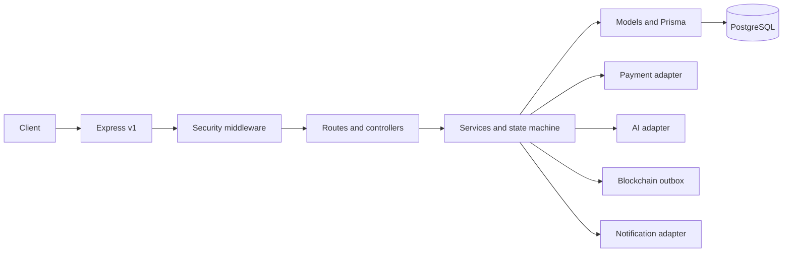

# Backend Architecture

Client → Express API v1 → security/auth/role/validation middleware → routes/controllers → domain services/state machine → Prisma models → PostgreSQL. Provider adapters isolate payment, notifications, AI and blockchain. Services own business rules; controllers only map HTTP; routes stay declarative.

## TB-BE-091 deterministic risk baseline

The AI module provides a separate deterministic baseline service alongside TB-BE-090's optional provider adapter. The baseline reads the same minimized, versioned transaction/payment/dispute aggregates under user-then-transaction row locks and persists append-only `RiskAssessment` rows. `AIAnalysis` remains the provenance store for external provider outputs. The route requires authenticated ADMIN, recent TOTP and a distinct shared rate-limit bucket; participants cannot retrieve internal findings. Baseline output is advisory review priority only and does not call a provider or mutate transaction, financial or account state.

TB-BE-092 adds a separate `createAiDisputeService` over the same configured adapter contract. It accepts only persisted `UNDER_REVIEW` disputes, count-only allowlisted evidence metadata and bounded identifier-redacted narrative; evidence contents, filenames, object keys and actor/transaction IDs are excluded. The admin route requires one-time dispute-bound `DISPUTE_REVIEW` step-up and a dedicated shared limiter. It appends a pending `AIAnalysis` with dispute version provenance and rejects stale results. AI output remains subordinate to the existing human review/resolution service.

The approved local development/testing database target is PostgreSQL 17.10 at `localhost:5432/Trustbridge`. The project uses Prisma ORM/CLI/client/PostgreSQL adapter 7.10.1; Prisma ORM 7 supports PostgreSQL 17.

TB-BE-025 applied `prisma/migrations/20261102153537_init/migration.sql` to the approved local PostgreSQL 17.10 database `Trustbridge` at `localhost:5432`. Prisma records one successful migration and reports the schema up to date. Direct catalog verification found 15 enums, 21 application tables, 98 indexes (77 explicit migration indexes plus 21 primary-key backing indexes), 33 restrictive foreign keys and 11 validated custom checks. Constraint probes ran in a transaction that was rolled back. No reset/drop/truncate or production database operation occurred.

TB-BE-030 adds reusable Zod registration/login input schemas at `src/validators/auth.validator.js` and an async bcrypt password service at `src/services/password.service.js`. TB-BE-031 wires `src/routes/auth.routes.js` to a thin controller and `src/services/auth.service.js`. Registration uses the shared Prisma client and an interactive Prisma transaction for User/Profile creation. The service forces `USER`/`ACTIVE`, translates unique collisions, and returns a minimal safe projection. Login selects the hash only for internal verification and returns the same projection. No JWT, session, refresh, logout or password-reset flow exists yet; login only verifies credentials. HTTP and service tests inject mocks, so they do not open a database connection.

The migration contains named row-level CHECK constraints for normalized email, positive transaction/ledger/evidence values, distinct transaction parties, positive versions, nonnegative escrow balance and nonnegative retry counts. These handwritten SQL constraints are not represented in Prisma's schema DSL. Ledger balance is enforced in TB-BE-060 by atomic service posting and exact integer validation. A deferred constraint trigger with parent-journal locking is required before alternate/direct ledger writes are allowed; no trigger is included now. Reversals use compensating journals, never mutation of posted entries.

## TB-BE-024 schema boundary

The canonical Prisma schema includes `RiskAssessment`, `AIAnalysis`, `BlockchainRecord` and `RefreshToken`. The AI provider service and deterministic baseline are described in TB-BE-090/091. Multiple analysis and chain records may exist per subject; nullable AI subject relations are supported, and application validation must require at least one subject. Human review and chain verification remain later service responsibilities.

Models cover users/profiles, participants, transactions, payments, escrow/ledger, disputes/evidence, notifications, audit, risk/AI, chain records and refresh tokens. Middleware covers authentication, role/ownership, Zod, rate limits, uploads, request context and errors. Config handles env, Prisma and providers; utils provide logging/errors/responses.

## Durable workflow persistence (TB-BE-026)

The schema now provides append-by-policy transaction status history, a provider webhook inbox, scoped idempotency records and a transactional outbox. Domain changes and outbox insertion must commit atomically. Worker claims use short leases and an atomic DB claim so crashed workers can be recovered; delivery remains at-least-once and consumers must be idempotent. No webhook, worker, payment execution or event-publishing code was added by this schema task.

Environment: src/config/env.js is the only application module that reads process.env. It exposes validateEnv(source) for isolated validation and getEnv() for one-time startup loading/caching. Zod validates NODE_ENV, PORT, PostgreSQL URL, separate JWT secrets/TTLs, and opt-in integration settings. Optional AI, blockchain and payment credentials are required only when enabled. Secret-bearing properties are non-enumerable to reduce accidental JSON/log disclosure; validation errors contain field names and safe guidance only. Prisma CLI uses getDatabaseUrl() so schema commands validate only the database URL and do not require application JWT secrets. Local environment variables are loaded lazily from .env; tests pass isolated objects and do not load the existing .env.

TB-BE-025-PRE fixes the dotenv lookup path: `src/config/env.js` resolves `.env` relative to the module/backend root instead of `process.cwd()`. This keeps Prisma CLI and application configuration stable when launched from a parent directory. Host-provided environment values retain precedence over the file; Zod PostgreSQL URL validation is unchanged.

State transitions are explicit and server-enforced; persist immutable actor/reason/from/to history. State, balanced double-entry ledger, audit and outbox writes use DB transactions. Use versioned conditional updates or row locks/serializable transactions, unique idempotency keys and bounded conflict retries. Separate payment attempt/order, capture verification, internal escrow funding record, release/refund authorization, provider payout/refund execution and final transaction status. Do not claim legal custody. High-risk AI recommendations require authorized human review, rationale and audit. Chain commitments exclude PII; failures remain pending/failed, signing keys have a managed lifecycle. The Express bootstrap consumes validated config, applies Helmet (without CSP), exact-origin CORS, request IDs, structured completion logging, bounded JSON/form parsing and an API-only configurable rate limiter before `/api/v1` routes. Logging runs after request-ID assignment but before CORS/parsing so denied preflights and parser failures are included; it records only request ID, method, matched route template or `unmatched`, status, duration, timestamp, level and event. It omits query strings, headers, IPs and bodies. Safe 404 and centralized parser/application/unexpected-error responses follow routes. `/health` remains the legacy liveness alias and `/health/live` reports process liveness (200); `/health/ready` returns 503 with database `not_checked` until a real readiness check exists. Health endpoints are outside API rate limiting. Middleware order is Helmet → request ID → request logger → CORS → parsers → API limiter → health/API routes → 404 → error handler; `src/server.js` owns HTTP listening and graceful signal shutdown. TB-BE-037 adds transaction creation, participant list/detail/history and a restricted participant lifecycle API over the existing Prisma models; payment/dispute/settlement transitions remain unimplemented in later modules.

Prisma lifecycle ownership resides in `src/config/db.js`. It dynamically loads the configured generated client and PostgreSQL adapter on explicit client access, so importing `src/app.js` neither creates a client nor connects. `connectDatabase()` performs explicit eager connection; `getPrismaClient()` shares one lazily initialized client. On shutdown, the server stops accepting requests and completes HTTP close before calling the centralized disconnect function; repeated shutdown calls share one promise. Generated Prisma 7 client code is TypeScript, so the Node 22 `start`/`dev` scripts enable experimental type stripping. The schema contains identity, transaction/financial, dispute/evidence, notification and audit records with canonical role and lifecycle enums. Evidence stores only private-storage metadata; audit append-only behavior requires database permissions/triggers and service controls beyond the Prisma model. Enums describe persisted values; state-transition authorization remains in services. Readiness stays `not_checked` and no DB check runs automatically until a bounded real probe is implemented.

Password-only login issues a normal session only for an active USER without active MFA. Active-MFA USERs and ADMINs first receive a five-minute opaque, hash-only LOGIN challenge; only successful TOTP verification yields tokens. ADMIN without enabled MFA cannot receive a session. Challenge consumption, current-user/security-version checks and TOTP replay-step claim occur in one serializable transaction. Failed code attempts are durable and capped at five.

Access JWTs pin validated HS256/issuer/audience and carry authorization version `av` plus refresh-session ID `sid`; MFA sessions also carry server-signed `mfa_at`. No role or MFA assurance comes from request data. Bearer middleware reloads current role/status/authVersion and, for MFA claims, confirms the refresh row is live and the timestamp matches; all MFA-required accounts must present this assurance. Refresh rechecks current account state and copies only the existing persisted assurance/version; it cannot upgrade a password-only token. Logout/reuse revokes the refresh row/family. MFA-assured access is checked against that revocation on protected requests; password-only USER access JWTs remain valid until expiry. Authorization changes must increment `User.authVersion` and invalidate applicable sessions/challenges.

Authorization middleware composes after authentication: `requireRole(s)` accepts only the schema's account roles (`USER`, `ADMIN`), while transaction and resource policies use the current `request.auth.userId`. Transaction access requires a `TransactionParticipant` row and agreement between its `BUYER`/`SELLER` role and the transaction's persisted buyer/seller ID; creator status alone grants nothing. Dispute/evidence checks traverse their actual transaction relations, payment/escrow checks traverse their transaction relation, and notification checks use `recipientId`. These policies are reusable building blocks and must be mounted on every protected route; no business endpoint was mounted in TB-BE-033.

## Privileged MFA persistence (TB-BE-034B)

`src/services/mfa-crypto.service.js` provides an authenticated-encryption boundary based on AES-256-GCM and an injected encryption-provider contract that performs encryption/decryption without exporting key material. The local provider is development/test-only; production rejects the local key setting, and no production KMS vendor or key is selected. `src/services/mfa-persistence.service.js` owns persistence operations for pending enrollment, verification-gated activation, monotonic TOTP replay steps, recovery-code batches/consumption, challenge state and two-approver recovery decisions. The service requires injected TOTP and independent identity-verification adapters and fails closed when they are absent. TB-BE-034B added no routes or controllers; authenticated enrollment routes were added separately in TB-BE-034C. Login challenge, JWT assurance and ADMIN enforcement were subsequently added in TB-BE-034D; trusted devices remain out of scope.

## TOTP enrollment API (TB-BE-034C)

`src/services/totp.service.js` implements RFC 6238 using Node.js crypto HMAC-SHA1, 160-bit random Base32 secrets, six digits and 30-second steps. The clock is injectable for deterministic tests; code comparison uses constant-time byte comparison. The validated skew setting is bounded to 0–2 steps (default 1). `src/services/mfa.service.js` composes this verifier with the 034B encrypted persistence boundary. Authenticated routes expose enrollment, verification and safe status. Verification and recovery-code issuance are committed together; replay state uses conditional updates. Enrollment secrets/URI are returned only at initiation and are excluded from structured request logs. A dedicated per-user limiter counts failed verification only. Login challenge, step-up, MFA disablement and recovery governance are not included.

`POST /api/v1/auth/mfa/challenge/verify` and login orchestration use those persistence/encryption interfaces for second-factor login. No sensitive business routes exist yet, so `createRecentMfaMiddleware()` is exported but not mounted globally. Login assurance defaults to 15 minutes; purpose-bound step-up is described below.

## Purpose-bound MFA step-up (TB-BE-034E)

`POST /api/v1/auth/mfa/step-up/challenge` and `/verify` require the existing verified Bearer session and active persisted TOTP. A challenge is a hash-only, five-minute default `STEP_UP` challenge bound to the current user, refresh-session row, authorization version, registered operation purpose, resource type/ID and exact MFA enrollment activation timestamp. The challenge category enum `purpose=STEP_UP` remains distinct from action key `operationPurpose`. Verification calls the existing TOTP verifier and persistence boundary; a serializable transaction claims the global accepted TOTP step and consumes the challenge. Failed codes increment the durable challenge count (maximum five). Successful verification records `verifiedAt` on the consumed challenge without issuing or rotating tokens and without changing JWT login assurance.

The `MfaChallenge` extension and restrictive RefreshToken relation are in additive migration `20261103170000_step_up_assurance`, applied to the preflight-verified approved local PostgreSQL 17.10 `Trustbridge` database. Catalog verification found all six columns, the restrictive FK, two indexes and validated binding CHECK; the public table count remains 27. Prisma reports no pending migration. Purpose registry entries declare resource requirements, allowed roles, max age and whether additional authorization remains necessary. The only registered purpose is `MFA_RECOVERY_CODES_REGENERATE` for the caller's own User record; the operation is not implemented. Future routes must compose `requireAuthentication`, existing role/ownership policy and then `createStepUpAuthorizationMiddleware` configured for the exact operation/resource. The middleware verifies the persisted grant, live same session, current account/MFA enrollment, authorization version and server-time freshness. MFA never substitutes for domain authorization. No step-up is mounted on a business route because no such operation exists yet.

Login MFA freshness (`mfa_at`) and purpose-specific step-up proof are separate: JWT claims describe the second factor at session creation/refresh; a step-up grant is the durable, session- and resource-bound challenge row. Refresh does not change or extend it. Logout/refresh rotation revokes the bound session and denies grants. Purpose policy max age currently defaults to five minutes. Both step-up endpoints have dedicated IP limits, using process-local express-rate-limit stores; multi-instance production requires shared storage. Unit tests use Prisma-shaped mocks; PostgreSQL concurrency verification remains outstanding.

## TB-BE-035-A1.2 — persisted authentication assurance

Refresh sessions now persist one of `PASSWORD_ONLY`, `TOTP_VERIFIED`, or `RECOVERY_CODE_VERIFIED`. Access JWTs carry the signed `al` assurance claim; authentication requires a valid `sid`, an allowlisted claim, and an exact assurance match with the live persisted refresh session. `request.auth.assuranceLevel` comes from that persisted record. TOTP evidence remains the nullable `mfaVerifiedAt` timestamp and must match the signed `mfa_at`; password and recovery sessions require it to remain null. Missing, unknown, inconsistent or mismatched values fail closed. A1.1's explicit legacy backfill provides `TOTP_VERIFIED` for rows with `mfa_verified_at` and `PASSWORD_ONLY` otherwise.

Password login issues `PASSWORD_ONLY`. TOTP login issues `TOTP_VERIFIED` and its verification timestamp. The existing login challenge endpoint also accepts a 32-hex-character recovery code; its hash is consumed atomically with challenge consumption and the resulting session is marked `RECOVERY_CODE_VERIFIED`, without fabricating TOTP time. Refresh copies the persisted level and timestamp exactly, rechecks account status, authVersion, active MFA, enrollment timing and session lifecycle, and never upgrades assurance. Purpose-bound step-up and recent-MFA authorization require `TOTP_VERIFIED`; recovery assurance cannot satisfy them. No schema change or migration was required for A1.2.
# TB-BE-050 guarded transaction lifecycle

Transaction delivery is implemented in `transaction-delivery.service.js`, with thin HTTP handlers and strict Zod commands. Seller work start checks funded escrow; seller submission and buyer decision lock the shared transaction row and update transaction version/history/audit together. Delivery evidence uses the same private evidence-storage abstraction as disputes and remains metadata-only in PostgreSQL. Payment, dispute resolution, release authorization, provider execution and ledger finalization remain separate services.

Transaction service policy is the sole authority for status transitions. It retains participant-derived buyer/seller roles, active account/authVersion checks, transaction row locking, expected-version compare-and-set, and atomic status-history/audit writes. Awaiting-payment cancellation is guarded by persisted `PaymentAttempt` existence; because provider verification is not implemented, any attempt blocks cancellation. Future attempt creation must acquire the transaction row lock before writing. Payment, escrow, dispute, transaction and payout workflows remain separate services; this task adds no provider or settlement logic.

## TB-BE-051 terms and invitation workflow

`transaction.service.js` owns terms versions, participant decisions and seller invitations. Transaction row locks serialize proposals, approvals, invitation issuance/response, cancellation and lifecycle transitions. Terms proposals use a unique transaction/version pair; decisions are unique per version/actor. The transaction snapshot amount/currency/terms changes only after both persisted participants accept the latest version. Seller transaction acceptance additionally requires an accepted invitation. Invitation issuance uses 32 random bytes and stores only a SHA-256 token hash; a conditional single-use update and invitee/account/version checks run under the transaction lock. Pending invitation rows are revoked in the same transaction as an ineligible status transition. Terms decisions, invitation events and transaction status history/audit writes are recorded atomically where state changes occur. Admin has no transaction ownership bypass. No terms or invitation operation calls payment, escrow, dispute, release or refund workflows.

## TB-BE-038 provider-neutral payment core

`payment.service.js` owns buyer authorization, accepted-terms amount/currency selection, idempotency, PaymentAttempt reservation, outbox dispatch leases, verified webhook normalization, state changes, reconciliation and payment audit events. Controllers validate empty initiation payloads and serialize safe summaries. Runtime uses only an explicitly injected adapter matching the configured provider; no production adapter is selected, so payment remains unavailable by default. Webhook routes receive raw JSON bytes captured by Express's verify hook before trusting parsed event data.

Payment initiation, verified provider event application, status reconciliation, and transaction cancellation all acquire the Transaction row lock before mutating their records. Provider network calls occur outside SQL transactions. The outbox claim uses a conditional update and lease; ambiguous results remain pending and retry with the stable provider idempotency key. Payment capture changes only PaymentAttempt and webhook/audit records. It never changes the transaction to FUNDED or creates escrow/ledger entries.
# TB-BE-070 provider adapter boundary

Razorpay is composed behind the existing payment adapter interface only when selected in validated configuration. The adapter owns provider HTTP, authentication, signature verification, status normalization and timeout handling; payment services continue to own participant/account checks, transaction-row locking, idempotency, inbox/outbox and audit. Adapter methods expose only allowlisted references/status, not provider bodies or credentials. Refund and Route adapter operations are isolated behind authorization callbacks and are not mounted as business routes. Razorpay Route approval, legal custody review and TB-BE-039 financial workflow remain prerequisites; payment capture never means escrow funding or transaction completion.

## TB-BE-039 escrow / ledger boundaries (IN PROGRESS)

Payment service calls the escrow funding recorder only after existing provider verification, inside its transaction-row-locked database transaction. It matches persisted transaction amount/currency and atomically writes escrow status/balance, unique funding operation, two-entry BigInt journal, transaction `FUNDED` history and audit. Release/refund APIs record one-time TOTP step-up-gated authorization and outbox work. The service revalidates account status/authVersion, exact live TOTP session/MFA enrollment, role and transaction/dispute state under transaction→user→session→MFA locks. Provider calls are outside DB transactions. Only an injected, verified outcome matching amount/currency can finalize and post the ledger journal. Default composition has no release/refund executor and leaves work pending. AI/blockchain data are not inputs to this authorization path.

Execution claims use one conditional `EscrowOperation.updateMany` lease acquisition (pending, due, lease absent/expired, attemptCount under five). Provider timeout/mismatch releases the lease and schedules a retry with a static safe error code; simultaneous workers cannot both call the executor. Exhausted attempts remain pending for manual reconciliation. Migration `20261104131000_escrow_execution_leases` provides the retry fields and index.

### TB-BE-039 Phase 2 runtime integration (2026-11-06)

`composeEscrowRuntime` connects approval-gated provider executors and persisted-operation authorization callbacks. The server starts the worker only after HTTP listen and drains an active tick before shutdown. DB leases provide cross-instance exclusion; local timer overlap is suppressed. Missing provider approval or Route account resolution leaves the relevant executor unavailable, without blocking ordinary HTTP startup.

## TB-BE-090 transaction risk assessment

`ai.service.js` gathers a repeatable-read snapshot containing only transaction status, integer minor amount/currency, age/version, and counts of payment-attempt/dispute statuses. It excludes names, emails, user IDs, descriptions, terms text, evidence, provider references and credentials. The assessment route is ADMIN-only, requires recent TOTP, validates a UUID and empty strict body, and uses a dedicated shared rate-limit bucket. `ai-provider.adapter.js` implements the vendor-neutral `trustbridge.ai.transaction-risk.v1` JSON gateway contract; provider, endpoint, model identifier/version and API key come from validated config. Redirects are disabled, responses are bounded, model provenance must match config, schema is strict, and at most one transient retry is made.

The result is stored in existing `AIAnalysis` as pending human review with input-data and transaction-version provenance. If transaction version changes while inference runs, persistence is rejected as stale. Neither model output nor service code is connected to transaction, payment, escrow, ledger, user-status or dispute-decision mutation. Provider configuration defaults disabled; no provider credentials or live call were used.
# TB-BE-041 Notifications and email

Domain events enqueue `USER_NOTIFICATION` outbox rows in the same business transaction. A supervised worker claims rows with the existing persisted lease fields, applies the recipient's notification preferences, and upserts a deduplicated in-app notification. HTTP handlers expose only recipient-owned list/read operations. Email is behind an injected provider-neutral adapter; no concrete production provider or credentials are configured. Worker retries are bounded and store only a sanitized error code. Provider delivery must support idempotency because a process can fail after provider acceptance but before the outbox acknowledgement.

## TB-BE-043 blockchain adapter

Transaction status-history services can enqueue hash-only `BlockchainRecord` plus outbox intent atomically. The Ethers adapter and supervised worker submit commitments and reconcile canonical receipts; the app fails closed if blockchain is explicitly enabled without an injected signer adapter. No blockchain endpoint or financial workflow is added. PostgreSQL remains authoritative, and no remote/testnet client is configured in the repository.
