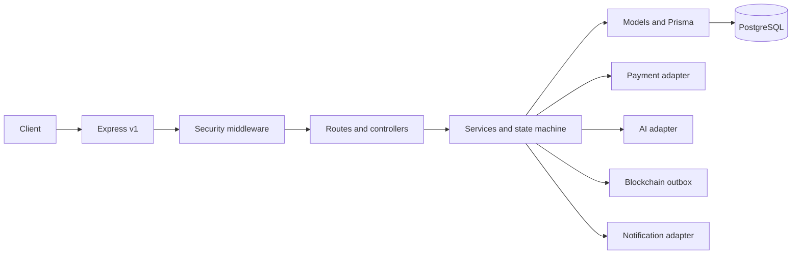

# Backend Architecture

Client → Express API v1 → security/auth/role/validation middleware → routes/controllers → domain services/state machine → Prisma models → PostgreSQL. Provider adapters isolate payment, notifications, AI and blockchain. Services own business rules; controllers only map HTTP; routes stay declarative.

The approved local development/testing database target is PostgreSQL 17.10 at `localhost:5432/Trustbridge`. The project uses Prisma ORM/CLI/client/PostgreSQL adapter 7.10.1; Prisma ORM 7 supports PostgreSQL 17.

TB-BE-025 applied `prisma/migrations/20261102153537_init/migration.sql` to the approved local PostgreSQL 17.10 database `Trustbridge` at `localhost:5432`. Prisma records one successful migration and reports the schema up to date. Direct catalog verification found 15 enums, 21 application tables, 98 indexes (77 explicit migration indexes plus 21 primary-key backing indexes), 33 restrictive foreign keys and 11 validated custom checks. Constraint probes ran in a transaction that was rolled back. No reset/drop/truncate or production database operation occurred.

TB-BE-030 adds reusable Zod registration/login input schemas at `src/validators/auth.validator.js` and an async bcrypt password service at `src/services/password.service.js`. TB-BE-031 wires `src/routes/auth.routes.js` to a thin controller and `src/services/auth.service.js`. Registration uses the shared Prisma client and an interactive Prisma transaction for User/Profile creation. The service forces `USER`/`ACTIVE`, translates unique collisions, and returns a minimal safe projection. Login selects the hash only for internal verification and returns the same projection. No JWT, session, refresh, logout or password-reset flow exists yet; login only verifies credentials. HTTP and service tests inject mocks, so they do not open a database connection.

The migration contains named row-level CHECK constraints for normalized email, positive transaction/ledger/evidence values, distinct transaction parties, positive versions, nonnegative escrow balance and nonnegative retry counts. These handwritten SQL constraints are not represented in Prisma's schema DSL. Ledger balance is enforced in TB-BE-060 by atomic service posting and exact integer validation. A deferred constraint trigger with parent-journal locking is required before alternate/direct ledger writes are allowed; no trigger is included now. Reversals use compensating journals, never mutation of posted entries.

## TB-BE-024 schema boundary

The canonical Prisma schema now includes `RiskAssessment`, `AIAnalysis`, `BlockchainRecord` and `RefreshToken`. These are persistence declarations only: no AI provider, blockchain client, wallet/signing, token generation/rotation API, or workflow/outbox was added. Multiple AI and chain records may exist per subject; nullable AI subject relations are supported, and application validation must require at least one subject. Human review and chain verification remain later service responsibilities.

Models cover users/profiles, participants, transactions, payments, escrow/ledger, disputes/evidence, notifications, audit, risk/AI, chain records and refresh tokens. Middleware covers authentication, role/ownership, Zod, rate limits, uploads, request context and errors. Config handles env, Prisma and providers; utils provide logging/errors/responses.

## Durable workflow persistence (TB-BE-026)

The schema now provides append-by-policy transaction status history, a provider webhook inbox, scoped idempotency records and a transactional outbox. Domain changes and outbox insertion must commit atomically. Worker claims use short leases and an atomic DB claim so crashed workers can be recovered; delivery remains at-least-once and consumers must be idempotent. No webhook, worker, payment execution or event-publishing code was added by this schema task.

Environment: src/config/env.js is the only application module that reads process.env. It exposes validateEnv(source) for isolated validation and getEnv() for one-time startup loading/caching. Zod validates NODE_ENV, PORT, PostgreSQL URL, separate JWT secrets/TTLs, and opt-in integration settings. Optional AI, blockchain and payment credentials are required only when enabled. Secret-bearing properties are non-enumerable to reduce accidental JSON/log disclosure; validation errors contain field names and safe guidance only. Prisma CLI uses getDatabaseUrl() so schema commands validate only the database URL and do not require application JWT secrets. Local environment variables are loaded lazily from .env; tests pass isolated objects and do not load the existing .env.

TB-BE-025-PRE fixes the dotenv lookup path: `src/config/env.js` resolves `.env` relative to the module/backend root instead of `process.cwd()`. This keeps Prisma CLI and application configuration stable when launched from a parent directory. Host-provided environment values retain precedence over the file; Zod PostgreSQL URL validation is unchanged.

State transitions are explicit and server-enforced; persist immutable actor/reason/from/to history. State, balanced double-entry ledger, audit and outbox writes use DB transactions. Use versioned conditional updates or row locks/serializable transactions, unique idempotency keys and bounded conflict retries. Separate payment attempt/order, capture verification, internal escrow funding record, release/refund authorization, provider payout/refund execution and final transaction status. Do not claim legal custody. High-risk AI recommendations require authorized human review, rationale and audit. Chain commitments exclude PII; failures remain pending/failed, signing keys have a managed lifecycle. The Express bootstrap consumes validated config, applies Helmet (without CSP), exact-origin CORS, request IDs, structured completion logging, bounded JSON/form parsing and an API-only configurable rate limiter before `/api/v1` routes. Logging runs after request-ID assignment but before CORS/parsing so denied preflights and parser failures are included; it records only request ID, method, matched route template or `unmatched`, status, duration, timestamp, level and event. It omits query strings, headers, IPs and bodies. Safe 404 and centralized parser/application/unexpected-error responses follow routes. `/health` remains the legacy liveness alias and `/health/live` reports process liveness (200); `/health/ready` returns 503 with database `not_checked` until a real readiness check exists. Health endpoints are outside API rate limiting. Middleware order is Helmet → request ID → request logger → CORS → parsers → API limiter → health/API routes → 404 → error handler; `src/server.js` owns HTTP listening and graceful signal shutdown. The Prisma schema now includes User/Profile plus Transaction/TransactionParticipant, PaymentAttempt, Escrow and LedgerAccount/LedgerJournal/LedgerEntry persistence models. Application APIs, business operations, migrations and authorization/state-machine services remain unimplemented.

Prisma lifecycle ownership resides in `src/config/db.js`. It dynamically loads the configured generated client and PostgreSQL adapter on explicit client access, so importing `src/app.js` neither creates a client nor connects. `connectDatabase()` performs explicit eager connection; `getPrismaClient()` shares one lazily initialized client. On shutdown, the server stops accepting requests and completes HTTP close before calling the centralized disconnect function; repeated shutdown calls share one promise. Generated Prisma 7 client code is TypeScript, so the Node 22 `start`/`dev` scripts enable experimental type stripping. The schema contains identity, transaction/financial, dispute/evidence, notification and audit records with canonical role and lifecycle enums. Evidence stores only private-storage metadata; audit append-only behavior requires database permissions/triggers and service controls beyond the Prisma model. Enums describe persisted values; state-transition authorization remains in services. Readiness stays `not_checked` and no DB check runs automatically until a bounded real probe is implemented.

Password-only login issues a normal session only for an active USER without active MFA. Active-MFA USERs and ADMINs first receive a five-minute opaque, hash-only LOGIN challenge; only successful TOTP verification yields tokens. ADMIN without enabled MFA cannot receive a session. Challenge consumption, current-user/security-version checks and TOTP replay-step claim occur in one serializable transaction. Failed code attempts are durable and capped at five.

Access JWTs pin validated HS256/issuer/audience and carry authorization version `av` plus refresh-session ID `sid`; MFA sessions also carry server-signed `mfa_at`. No role or MFA assurance comes from request data. Bearer middleware reloads current role/status/authVersion and, for MFA claims, confirms the refresh row is live and the timestamp matches; all MFA-required accounts must present this assurance. Refresh rechecks current account state and copies only the existing persisted assurance/version; it cannot upgrade a password-only token. Logout/reuse revokes the refresh row/family. MFA-assured access is checked against that revocation on protected requests; password-only USER access JWTs remain valid until expiry. Authorization changes must increment `User.authVersion` and invalidate applicable sessions/challenges.

Authorization middleware composes after authentication: `requireRole(s)` accepts only the schema's account roles (`USER`, `ADMIN`), while transaction and resource policies use the current `request.auth.userId`. Transaction access requires a `TransactionParticipant` row and agreement between its `BUYER`/`SELLER` role and the transaction's persisted buyer/seller ID; creator status alone grants nothing. Dispute/evidence checks traverse their actual transaction relations, payment/escrow checks traverse their transaction relation, and notification checks use `recipientId`. These policies are reusable building blocks and must be mounted on every protected route; no business endpoint was mounted in TB-BE-033.

## Privileged MFA persistence (TB-BE-034B)

`src/services/mfa-crypto.service.js` provides an authenticated-encryption boundary based on AES-256-GCM and an injected encryption-provider contract that performs encryption/decryption without exporting key material. The local provider is development/test-only; production rejects the local key setting, and no production KMS vendor or key is selected. `src/services/mfa-persistence.service.js` owns persistence operations for pending enrollment, verification-gated activation, monotonic TOTP replay steps, recovery-code batches/consumption, challenge state and two-approver recovery decisions. The service requires injected TOTP and independent identity-verification adapters and fails closed when they are absent. TB-BE-034B added no routes or controllers; authenticated enrollment routes were added separately in TB-BE-034C. Login challenge, JWT assurance and ADMIN enforcement were subsequently added in TB-BE-034D; trusted devices remain out of scope.

## TOTP enrollment API (TB-BE-034C)

`src/services/totp.service.js` implements RFC 6238 using Node.js crypto HMAC-SHA1, 160-bit random Base32 secrets, six digits and 30-second steps. The clock is injectable for deterministic tests; code comparison uses constant-time byte comparison. The validated skew setting is bounded to 0–2 steps (default 1). `src/services/mfa.service.js` composes this verifier with the 034B encrypted persistence boundary. Authenticated routes expose enrollment, verification and safe status. Verification and recovery-code issuance are committed together; replay state uses conditional updates. Enrollment secrets/URI are returned only at initiation and are excluded from structured request logs. A dedicated per-user limiter counts failed verification only. Login challenge, step-up, MFA disablement and recovery governance are not included.

`POST /api/v1/auth/mfa/challenge/verify` and login orchestration use those persistence/encryption interfaces for second-factor login. No sensitive business routes exist yet, so `createRecentMfaMiddleware()` is exported but not mounted globally. Login assurance defaults to 15 minutes; purpose-bound step-up is described below.

## Purpose-bound MFA step-up (TB-BE-034E)

`POST /api/v1/auth/mfa/step-up/challenge` and `/verify` require the existing verified Bearer session and active persisted TOTP. A challenge is a hash-only, five-minute default `STEP_UP` challenge bound to the current user, refresh-session row, authorization version, registered operation purpose, resource type/ID and exact MFA enrollment activation timestamp. The challenge category enum `purpose=STEP_UP` remains distinct from action key `operationPurpose`. Verification calls the existing TOTP verifier and persistence boundary; a serializable transaction claims the global accepted TOTP step and consumes the challenge. Failed codes increment the durable challenge count (maximum five). Successful verification records `verifiedAt` on the consumed challenge without issuing or rotating tokens and without changing JWT login assurance.

The `MfaChallenge` extension and restrictive RefreshToken relation are in additive migration `20261103170000_step_up_assurance`, applied to the preflight-verified approved local PostgreSQL 17.10 `Trustbridge` database. Catalog verification found all six columns, the restrictive FK, two indexes and validated binding CHECK; the public table count remains 27. Prisma reports no pending migration. Purpose registry entries declare resource requirements, allowed roles, max age and whether additional authorization remains necessary. The only registered purpose is `MFA_RECOVERY_CODES_REGENERATE` for the caller's own User record; the operation is not implemented. Future routes must compose `requireAuthentication`, existing role/ownership policy and then `createStepUpAuthorizationMiddleware` configured for the exact operation/resource. The middleware verifies the persisted grant, live same session, current account/MFA enrollment, authorization version and server-time freshness. MFA never substitutes for domain authorization. No step-up is mounted on a business route because no such operation exists yet.

Login MFA freshness (`mfa_at`) and purpose-specific step-up proof are separate: JWT claims describe the second factor at session creation/refresh; a step-up grant is the durable, session- and resource-bound challenge row. Refresh does not change or extend it. Logout/refresh rotation revokes the bound session and denies grants. Purpose policy max age currently defaults to five minutes. Both step-up endpoints have dedicated IP limits, using process-local express-rate-limit stores; multi-instance production requires shared storage. Unit tests use Prisma-shaped mocks; PostgreSQL concurrency verification remains outstanding.
