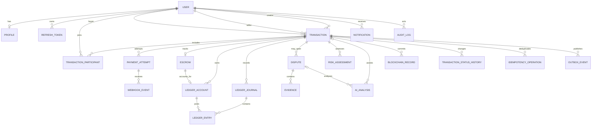

# Database Design

PostgreSQL 17 is the approved local development/testing baseline; Prisma 7 is authoritative. The verified local instance is PostgreSQL 17.10 at localhost:5432, database `Trustbridge`. Prisma ORM 7.10.1, client 7.10.1 and PostgreSQL adapter 7.10.1 are used; Prisma ORM 7's official supported-database list includes PostgreSQL 17. TB-BE-020 established the schema generator/datasource configuration and domain enums; TB-BE-021 implemented User/Profile; TB-BE-022 implemented transaction, participant, payment-attempt, escrow and ledger models; TB-BE-023 implements dispute, evidence, notification and audit records; TB-BE-024 implements risk/AI, blockchain and refresh-token records; TB-BE-026 implements durable workflow records. TB-BE-025 applied and verified the initial migration on the approved local database. It remains separate from business migrations and does not implement service-level ledger posting.

| Entity | Proposed core fields/constraints |
|---|---|
| User/Profile | UUID/CUID, normalized unique email, password hash/status/timestamps; profile 1:1, minimal PII |
| Transaction/Participant | terms, status/version, creator, amountMinor BIGINT, ISO currency; participant role/invite, unique transaction+user. Record immutable transition actor/from/to/reason/time. |
| Payment/PaymentAttempt | transaction, provider, unique provider refs, amount/currency/status/idempotency, attempts and failure codes; never card data. Attempt state is separate from transaction state. |
| WebhookEvent | provider event ID unique per provider/account, verified timestamp, received/processed state, redacted bounded payload/reference and retry metadata; durable inbox before acknowledging. |
| EscrowAccount/Ledger | account per transaction/currency; immutable double-entry journal with journal/operation ID, account, positive integer amount, debit/credit and currency. Entries balance to zero per journal/currency; corrections use compensating journals. |
| IdempotencyOperation/OutboxEvent | scoped unique idempotency key and request fingerprint/result state; outbox ID/type/aggregate/minimal payload/retry/confirmation. Commit with originating state change. |
| Dispute/Evidence | transaction/opener/category/status/resolution/admin actor; opaque private storage key, uploader, sanitized filename/type/size/hash metadata; no file contents or public URLs |
| Notification | recipient/type/title/message/read timestamp/dedupe key; no credentials or evidence content |
| AuditLog | optional actor/action/resource type+ID/request ID/allowlisted metadata/time; append-only controls required |
| RiskAssessment/AIAnalysis | scoped score/result, indicators, recommendation, provider/rules/model version, reviewer/provenance |
| BlockchainRecord | event hash/type/network/reference/confirmation/status/unique idempotency key |
| RefreshToken | user, unique token hash, expiry/revocation/rotation; minimize device metadata |

Use integer minor units and currency codes, never floats. Validate amount bounds and currency exponent; no silent currency conversion. Ledger is append-only double-entry; restrict update/delete permissions where practical and correct only with compensating journals. For state/escrow concurrency use versioned conditional updates or row locks/serializable transactions with bounded retry; uniqueness constraints guard duplicates. Add foreign keys/indexes for ownership, provider refs, queue scans and pagination. Store only password/token hashes. Keep PII/evidence off-chain. Define retention and webhook payload redaction. Resolve duplicate schema paths and validate Prisma config before migrations.

## Canonical schema foundation (TB-BE-020)

`prisma/schema.prisma` is the sole authoritative schema, with PostgreSQL datasource, Prisma 7 `prisma-client` generator and output `../generated/prisma`. It defines `User`, `Profile`, `Transaction`, `TransactionParticipant`, `PaymentAttempt`, `Escrow`, `LedgerAccount`, `LedgerJournal`, `LedgerEntry`, `Dispute`, `Evidence`, `Notification` and `AuditLog`, and shared enums `UserRole`, `UserStatus`, `ParticipantRole`, `TransactionStatus`, `PaymentAttemptStatus`, `EscrowStatus`, `DisputeStatus`, `ProviderOperationStatus`, `AiReviewStatus`, `BlockchainOperationStatus`, `LedgerAccountType` and `LedgerDirection`. Enums are vocabulary only: they do not authorize transitions, payment results, fund movement, dispute rulings or blockchain finality. The transaction transition graph remains service-enforced.

TB-BE-021 implements the justified identity-side `User` and `Profile` models. TB-BE-022 adds `Transaction`, `TransactionParticipant`, `PaymentAttempt`, `Escrow`, `LedgerAccount`, `LedgerJournal` and `LedgerEntry`. TB-BE-023 adds `Dispute`, `Evidence`, `Notification` and `AuditLog`. TB-BE-024 adds `RiskAssessment`, `AIAnalysis`, `BlockchainRecord` and `RefreshToken`. TB-BE-026 adds `TransactionStatusHistory`, `WebhookEvent`, `IdempotencyOperation` and `OutboxEvent`, with workflow-specific `WebhookProcessingStatus`, `IdempotencyStatus` and `OutboxStatus` enums. These are separate from provider-operation and payment-attempt state vocabularies. `ParticipantRole` remains distinct from account `UserRole`; neither enum substitutes for authorization middleware.

`User.email` stores canonical lowercase/trimmed form and has database uniqueness plus the applied migration CHECK preventing noncanonical direct writes. `User` stores only `passwordHash`, role and status, avoiding extra identity fields. `Profile` is optional one-to-one, has a unique required `userId`, optional `displayName`, and does not duplicate authentication or payment fields. User status supports deactivation; dependent relations must use restrictive deletion behavior to preserve identity references and financial/audit history.

For `User`, unique email and status/createdAt plus role/status lookup indexes are present; for `Profile`, unique `userId` enforces one-to-one. Its foreign key uses `onDelete: Restrict` and `onUpdate: Cascade`.

## Transaction, payment, escrow and ledger models (TB-BE-022)

`Transaction` binds explicitly named buyer, seller and creator User relations using restrictive deletion. It stores status, optimistic `version`, JSONB commercial `terms`, `amountMinor` (`BigInt`) and ISO currency (`CHAR(3)`). Composite `(id,currency)` uniqueness supports currency-matched financial foreign keys. Buyer/status/date, seller/status/date, status/date and creator/date indexes support owner/status history queries. The state enum does not enforce the permitted transition graph.

`TransactionParticipant` references the real Transaction and User. Composite primary key `(transactionId,userId)` prevents duplicate membership; unique `(transactionId,role)` limits a transaction to one row per participant role. User/role/joinedAt supports participant lookups. `PaymentAttempt` has its own status, provider-neutral provider/reference, per-transaction idempotency key, amount/currency, safe failure code, timestamps and transaction/status/provider indexes. Provider reference is unique per provider; transaction-scoped idempotency keys are unique. A payment attempt's `CAPTURED` state must only be persisted after server-side provider verification; client claims are untrusted.

TB-BE-037 writes only these existing records. Creation forces the authenticated USER to `buyerId` and `createdById`, validates a distinct existing active USER as seller, and inserts BUYER/SELLER memberships. There is no separate invitation model: `CREATED` is the pending seller invitation state; seller ACCEPTED/REJECTED or buyer CANCELLED is recorded in the transaction lifecycle. Initial history uses version 1 and null previous status. Every later transition locks the transaction row, checks the caller's live participant row and expected version, conditionally increments the version, and inserts history plus AuditLog in the same database transaction. Unique `(transactionId,version)` is the final duplicate-history guard. Idempotent creation uses the existing `IdempotencyOperation` keyed by authenticated buyer scope and client key, storing only a keyed fingerprint and transaction reference; raw terms are not stored in the idempotency record.

For TB-BE-037 only participant initiation transitions are exposed: CREATED→ACCEPTED/REJECTED (seller), CREATED→CANCELLED (buyer), ACCEPTED→AWAITING_PAYMENT (buyer), and AWAITING_PAYMENT→CANCELLED (buyer). The broader canonical graph remains the roadmap for TB-BE-050–053. FUNDED, DISPUTED, RELEASE_PENDING, REFUND_PENDING and terminal settlement states cannot be asserted through this API; payment verification, dispute resolution and payout/refund evidence remain separate services/tasks.

`Escrow` is one currency-matched record per transaction, with integer `balanceMinor`, status and optional funded/released/refunded timestamps. It is an internal record and does not imply legal custody. It can have one linked `LedgerAccount`; the account and escrow composite foreign key ties transaction and currency together.

Ledger accounts are scoped to a transaction/currency, have a stable `accountCode` and standard accounting `accountType`. Journals have globally unique `operationId`, transaction/currency, creation timestamp and optional self-reference to the journal they compensate. Entries have positive-intended `BigInt amountMinor`, `DEBIT`/`CREDIT`, creation timestamp, and composite foreign keys requiring the referenced journal and account to match both transaction and currency. Relations use `RESTRICT` for deletion and financial key/currency updates; no financial row can cascade-delete with its owner. Lookup indexes cover transactions, statuses, provider, journal, account, reversal and participant queries.

The Prisma schema does **not** encode the applied SQL CHECKs for positive Transaction/LedgerEntry amounts, nonnegative Escrow balance, distinct buyer/seller, positive versions, or normalized email. PostgreSQL 17.10 enforces these checks. Journal minimum entry count, zero-sum balancing per journal/currency, reversal arithmetic, append-only behavior, and equality between Transaction buyer/seller and participant role rows remain unimplemented integrity controls for TB-BE-060/TB-BE-121. The schema supports balanced per-currency groups via shared currency and direction fields, but does not guarantee they balance. A signed PostgreSQL `BIGINT` ranges from -9,223,372,036,854,775,808 to 9,223,372,036,854,775,807 minor units; positive operation amounts must stay within the signed maximum. Currency code validity/exponent and amount upper bounds remain application constraints.

### Initial migration integrity review (TB-BE-025, applied)

The applied initial migration adds named row-level PostgreSQL CHECK constraints for positive transaction and ledger amounts, distinct buyer/seller IDs, positive transaction and status-history versions, nonnegative escrow balance and workflow attempt counters, positive evidence size, and canonical lowercase/trimmed email (`email = lower(btrim(email))`). The canonical Prisma schema does not express these checks; preserve them as reviewed custom SQL in the migration and keep the static migration-contract test aligned. PostgreSQL 17.10 verification confirmed all 11 checks are present and validated, and transactional probes confirmed rejection/acceptance semantics with all probe writes rolled back. The checks do not validate email syntax, amount upper bounds, currency codes/exponents, or participant-role consistency.

Double-entry journal integrity is cross-row: each committed journal must have at least two positive entries and debit total equal credit total in its one currency. A row CHECK cannot enforce count or aggregate balance. TB-BE-060 must enforce construction atomically in the ledger service: serialize on the journal/transaction financial owner, insert all entries in one DB transaction, verify count/currency/totals using exact integer arithmetic before commit, and use unique operation IDs for idempotency. Before permitting any alternate/direct ledger writer, add a deferred PostgreSQL constraint trigger that validates affected journals at commit and locks the parent journal row to serialize competing writers. Ledger entries/journals remain append-only; corrections are new compensating journals, never edits. Trigger design and concurrency/reversal tests remain deferred to TB-BE-060/TB-BE-121; no trigger is in this draft.

## Dispute, evidence, notification and audit models (TB-BE-023)

`Dispute` references a real transaction and initiating User, with optional resolving User, existing `DisputeStatus`, category/description, resolution and created/updated/resolved/closed timestamps. Multiple disputes per transaction are permitted by the existing ER design; no unique transaction constraint was added. Transaction/status/date and actor/date indexes support case queries. A dispute status is not a resolution authorization.

`Evidence` references its dispute and uploader. It stores category, a unique opaque private `storageObjectKey`, optional sanitized original basename, content type, `BigInt sizeBytes`, SHA-256 hash and creation time. No binary content, public URL, signed URL, token or access capability is stored. The storage key is a locator only; access requires separate authorization and private-storage controls. Enforce upload limits, allowed types, malware checks and filename sanitization in later upload work.

### TB-BE-040 dispute workflow extension

Additive migration `20261107100000_dispute_evidence_management` adds `DisputeActivityType`, a version counter, nullable evidence/response deadlines and nullable positive `resolutionAmountMinor` to `Dispute`, plus ordered `DisputeActivity` records. Activities retain sequence, actor (nullable only for system closure), type, bounded message/metadata and timestamp; `(disputeId, sequence)` is unique. Restrictive relations and indexes support dispute chronology and actor chronology. CHECK constraints enforce positive version/sequence and positive partial-resolution amounts. No file bytes, public URL, or provider/security secrets are stored. Migration was applied only to identity-verified isolated `trustbridge_test`; development and production databases were not accessed.

The service locks Transaction before User and Dispute, updates transaction status/history and dispute activity/audit atomically, and uses expected-version conditional updates. `DisputeActivity` is append-only by application behavior; database-enforced immutability would require separate DB privileges/triggers. Evidence points to private object storage. The default storage adapter fails closed; no production storage provider is configured.

`Notification` references its recipient and stores type, title, optional message, optional per-recipient dedupe key, nullable `readAt`, and created/updated timestamps. Recipient/date, recipient/read/date and type/date indexes support inbox queries. Notifications are informational and never grant access or authorization. No provider delivery metadata is added without a provider design.

`AuditLog` supports nullable actor User for system events, action, polymorphic entity type/ID, request correlation ID, optional JSON metadata and creation timestamp. Indexes support actor, action, resource, request and chronological queries. The schema contains no update timestamp and the model is designed for append-only use; Prisma alone cannot prevent updates or deletes. Before audit writes are enabled, restrict database grants and add reviewed triggers/policies, redact and allowlist metadata, and test immutability. Restrictive FKs prevent deleting referenced users, disputes, evidence or notifications with their owners; no cascade deletion is configured.

## AI, blockchain and refresh records (TB-BE-024)

`RiskAssessment` stores ruleset-versioned, transaction-scoped indicators, a bounded-intended score/risk level, recommendation and optional human review fields. `AIAnalysis` stores provider/model identifier and version, analysis type, structured result and optional explainability data; it may relate to a transaction, a dispute, or both, with the application required to provide at least one subject. Both reuse `AiReviewStatus`, permit multiple records per subject, and use restrictive relations and queue/history indexes. Prisma cannot enforce a non-null score range, a valid subject combination, completion/review timestamp consistency, or that review actually came from an authorized human. Results and JSON metadata must be minimized and redacted. These records are advisory; they never authorize funding, release, refund, payout, account bans or final dispute resolution.

`BlockchainRecord` stores one or more operations per transaction, a network/optional contract reference, operation type, event hash, transaction/block references, scoped idempotency key, safe error code, status and lifecycle timestamps. `(transactionId,idempotencyKey)` prevents duplicate operations; `(network,transactionHash)` is unique when a hash is present. Only hashes and opaque references belong here: no raw payload, PII, evidence, credential or signing material. A submitted hash does not prove inclusion, confirmation depth, canonicality or finality. Later chain verification/reconciliation logic must gate any confirmed status; database constraints do not establish those facts.

`RefreshToken` stores a unique token hash, user, family UUID, expiry, creation/last-use, revocation reason/time, reuse-detection time and optional unique predecessor reference in a restrictive self-relation. Rotation lineage supports later replay detection while keeping raw bearer tokens out of storage. Hash strength/algorithm, expiry ordering, family-wide revocation on detected reuse, and one-time rotation semantics require reviewed service logic and, where race safety requires it, transactional constraints/locking. Never log token hashes. Restrictive user/self references preserve security history; retention/purge policy remains to be decided before production.

All future money fields use PostgreSQL signed `BIGINT` through Prisma `BigInt`, in integer minor units (for INR, paise), accompanied by an explicit ISO 4217 currency code (`CHAR(3)` where supported by the chosen model). A signed 64-bit value has maximum `9,223,372,036,854,775,807`; applications must enforce positive bounded operation amounts and currency exponent rules. TB-BE-025's migration adds and verifies row-level positive/nonnegative checks, but Prisma schema syntax does not express them and no cross-row balanced-journal constraint is yet implemented. Never use `Float` or `Decimal` for settled minor-unit amounts. Journals remain append-only double entry, balance per currency, use unique operation identifiers, and are corrected by compensating entries only. No schema object implies TrustBridge legally holds funds.

TB-BE-032 uses the existing `RefreshToken` schema: each 256-bit random refresh token is stored only as a unique SHA-256 digest, linked to a user and family, with expiry/revocation timestamps and a unique predecessor relation. Conditional update and family revocation run in one Prisma transaction. Prisma uniqueness and PostgreSQL row locking arbitrate concurrent refresh attempts; actual database race behavior still requires the guarded integration suite. No schema change or migration was needed.

Authorization relies on live persisted relationships, not request fields. A transaction participant is valid only when the `TransactionParticipant` row's `BUYER`/`SELLER` role agrees with the authenticated user's corresponding `Transaction.buyerId`/`sellerId`; the creator relation is not sufficient. The database schema does not currently enforce this cross-table consistency, so service writes must preserve it and the authorization policy denies mismatched rows. Dispute and evidence access is derived by traversing Dispute→Transaction and Evidence→Dispute→Transaction; notification ownership uses recipient ID. PostgreSQL integration coverage remains deferred to the isolated integration suite.

## Financial workflow separation
1. Payment order/attempt creation is not escrow funding.
2. Provider capture is trusted only after server verification or verified durable webhook.
3. Escrow funding ledger/status is a distinct internal accounting record, not legal custody.
4. Release/refund authorization records policy approval only.
5. Provider payout/refund execution is a separate idempotent external operation; final transaction status requires verified provider result.
6. Reconciliation compares provider events, attempts, journals and transaction state. Mismatches require review; never silently rewrite ledger entries.

## Prisma client lifecycle (TB-BE-015)

The authoritative schema remains `prisma/schema.prisma`, with Prisma 7's configured `prisma-client` output at `generated/prisma`. `src/config/db.js` is the sole client factory/access point and uses the installed `@prisma/adapter-pg` 7.10.1 adapter with `pg` 8.23.1. Client construction is lazy and shared; `getPrismaClient()` initializes without forcing a network connection, while `connectDatabase()` explicitly calls `$connect()`. `disconnectDatabase()` is safe when unused, cleans up and resets the shared instance after disconnect, and returns sanitized errors. The app import has no DB side effect.

Server shutdown first closes the HTTP listener and then calls the database disconnect entry point once, even when multiple shutdown signals race. No connection probe is performed by health/readiness. Identity models are now present; the lifecycle task itself added no models or migrations. Future schema and database workflow tasks must use a verified disposable test database for integration checks.

## Initial migration (TB-BE-025, applied and verified)

Prisma 7.10.1 create-only generated `prisma/migrations/20261102153537_init/migration.sql` for the approved local PostgreSQL 17.10 target `localhost:5432/Trustbridge`, and TB-BE-025 applied it with `prisma migrate deploy`. PostgreSQL catalog verification found 15 enums, 21 application tables, 98 indexes (77 explicit SQL index statements plus 21 primary-key backing indexes), and 33 restrictive foreign keys. Financial amounts/balances are `BIGINT`; all six currency columns are `CHAR(3)`. All 11 custom CHECK constraints are present and validated, and transactional negative/positive probes passed with all test writes rolled back. No unexpected application tables were present. The migration is recorded successful and Prisma reports no pending migrations. No reset/drop/truncate was run. Preserve `_prisma_migrations`. Cross-row journal balance, append-only controls, status transitions, event/JSON redaction and atomic worker claims remain service/database-control work assigned to later tasks; TB-BE-060 owns ledger posting and the future deferred balance trigger.

## Durable workflow records (TB-BE-026)

`TransactionStatusHistory` stores transaction, nullable previous status (null is valid for initial creation), required new status, optional system/user actor, reason, timestamp and transaction version. Unique `(transactionId,version)` protects one transition record per optimistic version; transaction/time supports chronology. It is append-only by policy; PostgreSQL grants/triggers and atomic transaction+history writes are required to enforce it.

`WebhookEvent` is a durable provider inbox keyed uniquely by `(provider,providerAccountScope,eventId)`, with event type/time, optional PaymentAttempt association, processing status, attempt count, retry time, lease and safe error code. `eventData` may contain only an allowlisted minimal redacted envelope; never store raw signed requests, headers, credentials, card data or unrestricted provider payloads. Acknowledge only after durable insert in the future webhook integration. Attempt bounds and status/timestamp consistency require service/DB checks.

`IdempotencyOperation` scopes unique keys by `(operationScope,idempotencyKey)`, records an HMAC-derived fixed-length request fingerprint, lifecycle status, polymorphic resource type/ID, lease/attempt metadata and expiry. It intentionally stores no raw request or response body and has no polymorphic FK; services must validate resource references and reject key reuse with a different fingerprint. Keep an expired key until no in-flight operation can still commit; define retention and collision-safe HMAC key rotation before API use.

`OutboxEvent` stores a unique stable event key, event type, aggregate reference, optional Transaction FK, minimal sanitized JSON payload, publication state, attempt count, retry time, lease owner/expiry, safe last error and published timestamp. Insert the outbox row in the same database transaction as the aggregate change. Workers need an atomic claim operation (for example, conditional update/`FOR UPDATE SKIP LOCKED` with a bounded lease), lease-expiry recovery, bounded backoff and idempotent downstream consumers. The schema fields alone do not guarantee atomic claims, exactly-once delivery or payload redaction. Attempt non-negativity, status/lease coherence, retention and append-only history need reviewed SQL checks/permissions and service tests.

## Authorization relationship rules (TB-BE-033)

The account role enum is exactly `USER` and `ADMIN`; participant roles are a separate enum, exactly `BUYER` and `SELLER`. Transaction access requires the authenticated user's `TransactionParticipant` row and requires that its role correspond to `Transaction.buyerId` or `Transaction.sellerId`. `createdById` is not an authorization substitute. The schema has no cross-table constraint enforcing this participant/party match, so writes must preserve it and authorization denies inconsistent rows. Dispute and evidence access traverses the dispute's actual transaction; payment-attempt and escrow access traverses their transaction relation. Notification ownership uses `recipientId`. None of these policies grants admin an implicit resource-ownership bypass.

## MFA and account recovery persistence (TB-BE-034B)

The additive migrations `prisma/migrations/20261103090000_mfa_persistence/migration.sql` and `prisma/migrations/20261103100000_mfa_enrollment_status/migration.sql` add `UserMfa`, `MfaRecoveryCode`, `MfaChallenge`, `AccountRecoveryRequest`, and `RecoveryApproval`, plus `User.authVersion`, `RefreshToken.authVersion`, and `RefreshToken.mfaVerifiedAt`. All user/request references use restrictive foreign keys. `UserMfa` is one-to-one with User and stores active/pending AES-GCM envelopes as ciphertext, 12-byte nonce, 16-byte authentication tag, key ID/version, activation and pending-expiry timestamps, and the last accepted TOTP time step, plus explicit `DISABLED`/`PENDING`/`ENABLED` enrollment status. The applied database has named CHECKs for complete-or-empty envelopes, enabled-secret presence, nonnegative time steps/attempt/auth versions, one recovery-code terminal timestamp, positive recovery version and paired identity-verification timestamp. TOTP uses 6 digits and 30-second steps; `MFA_TOTP_WINDOW_STEPS` is configurable from 0–2 and defaults to one; HTTP verification and role enforcement are later work.

Recovery codes are 128-bit random values returned once and stored only as SHA-256 digests, with batch, consumed and invalidated timestamps. Conditional `updateMany` consumption and PostgreSQL transactions make a code single-use; regeneration invalidates all prior unused rows before inserting the new batch. `MfaChallenge` stores only a SHA-256 digest of an opaque challenge, its purpose, auth-version snapshot (checked against the live user version), expiry and bounded attempt counter. Recovery requests keep only an opaque external verification reference, not identity documents. `RecoveryApproval` has a unique request/approver pair; service policy requires active ADMIN approvers, completed independent identity verification, excludes the target account, and moves to APPROVED only after two distinct approvals. Database uniqueness prevents duplicate decisions by one approver; cross-record role, identity-verification, expiry and two-approver rules are service-enforced.

Migrations `20261103090000_mfa_persistence` and `20261103100000_mfa_enrollment_status` were applied to the approved local PostgreSQL 17.10 `Trustbridge` database. Direct catalog verification found 26 application tables (plus `_prisma_migrations`), four new enums, 12 new indexes, 7 new restrictive foreign keys, and 10/10 new validated checks; both migrations are recorded successful and Prisma reports no pending migrations. No integration suite was run against this development database; PostgreSQL concurrency behavior still needs a separately designated disposable test database. No MFA API or authentication-flow integration was added.

## Login MFA/session assurance (TB-BE-034D)

No schema change or migration was required. Existing `MfaChallenge` provides hash-only token, purpose, expiry, failed-attempt count, consumed time and account `authVersion`; `RefreshToken` persists `authVersion` and nullable `mfaVerifiedAt`, while `User.authVersion` invalidates earlier challenges and sessions after security changes. Challenge consumption and TOTP-step claim use a single serializable persistence transaction; authentication then creates the refresh row. These are service-level transactional guarantees and still require concurrency verification on a separate disposable PostgreSQL target. Authorization/security changes must increment `User.authVersion`; no direct role mutation endpoint exists yet.

## Purpose-bound step-up assurance (TB-BE-034E)

The additive schema change in `prisma/migrations/20261103170000_step_up_assurance/migration.sql` extends `MfaChallenge` with nullable `sessionId` (restrictive FK to `RefreshToken`), operation-specific `operationPurpose`, `resourceType`, `resourceId`, `mfaEnabledAt` and `verifiedAt`. The existing enum `purpose` continues to identify the challenge category (`STEP_UP`); it is distinct from `operationPurpose`, which holds the registered action key. It adds indexes for session/consumption and user/session/operation-purpose/resource/recent assurance lookup. A custom SQL CHECK requires STEP_UP rows to have the session/operation/resource/enrollment binding and consistent verified/consumed timestamps; non-STEP_UP rows must leave the new fields null. Prisma schema validation cannot express this check, so migration integrity tests inspect the SQL. The migration was reviewed and applied to the preflight-verified approved local PostgreSQL 17.10 database. Read-only catalog verification found 27 public tables, all six columns, the restrictive FK, both indexes and the validated CHECK; Prisma reports no pending migration. No PostgreSQL concurrency test used the development database.

The challenge row itself is the durable assurance record after success: `verifiedAt` is server-set only in the same serializable transaction that claims `UserMfa.lastAcceptedTimeStep` and sets `consumedAt`. The challenge binds `userId`, `sessionId`, `authVersion`, exact `operationPurpose`/resource and MFA `enabledAt`. Middleware accepts only a consumed row whose timestamp is within the purpose's max age and whose user, MFA enrollment and refresh session remain active. Session revocation/expiry, account inactivity/version change, or MFA enrollment replacement makes the grant unusable. There is no separate assurance table, new session or JWT mutation.

Current allowlisted purpose: `MFA_RECOVERY_CODES_REGENERATE`, resource type `USER`, required resource ID equal to the authenticated user's UUID, allowed account roles USER/ADMIN, 300-second max assurance age, and additional authorization required. No regeneration operation or route is implemented. Future operations must register specific purposes and still enforce domain authorization. PostgreSQL concurrency integration for challenge/TOTP races remains pending a separately designated disposable database.

## Persistent authentication assurance foundation (TB-BE-035-A1.1)

Prisma defines `MfaAssuranceLevel` (`PASSWORD_ONLY`, `TOTP_VERIFIED`, `RECOVERY_CODE_VERIFIED`) and maps `RefreshToken.assuranceLevel` to `refresh_tokens.assurance_level` with default `PASSWORD_ONLY`. Migration `20261104110000_mfa_assurance_level` creates the PostgreSQL enum, adds the non-null defaulted column, then maps legacy rows from `mfa_verified_at`: non-null to `TOTP_VERIFIED`, null to `PASSWORD_ONLY`. It does not update or remove `mfa_verified_at` or other refresh-token fields. The migration is created and contract-tested but has NOT been applied; runtime assurance behavior remains unchanged in this stage.

## TB-BE-035-A1.1 — MFA assurance migration applied (2026-11-04)

Migration `20261104110000_mfa_assurance_level` is applied to the approved local PostgreSQL 17.10 `Trustbridge` database at localhost:5432. It creates `MfaAssuranceLevel` with exactly `PASSWORD_ONLY`, `TOTP_VERIFIED`, and `RECOVERY_CODE_VERIFIED`; adds non-null `refresh_tokens.assurance_level` with default `PASSWORD_ONLY`; and backfills legacy rows according to `mfa_verified_at` while leaving that TOTP evidence column unchanged. Read-only catalog verification found the enum labels in the expected order, the mapped column as `MfaAssuranceLevel NOT NULL DEFAULT 'PASSWORD_ONLY'`, and the original nullable `mfa_verified_at` column intact. There were zero refresh-token rows at verification time, so no legacy rows required backfill. Prisma recorded the migration successful and reports the schema up to date. This schema foundation does not change runtime authentication behavior; TB-BE-035-A1.2 remains outstanding.
# TB-BE-050 lifecycle compatibility

The existing `TransactionStatus`, `PaymentAttemptStatus`, `EscrowStatus` and `DisputeStatus` remain separate. `TransactionStatusHistory(transactionId, version)` uniqueness and existing `AuditLog`, `IdempotencyOperation`, `WebhookEvent` and `OutboxEvent` are reused. Migration `20261107110000_transaction_delivery_workflow` adds `transaction_deliveries` (unique transaction/sequence), `delivery_decisions` (unique delivery, immutable by service policy), and nullable `evidence.transaction_delivery_id`. Existing dispute evidence retains its `dispute_id`; a PostgreSQL CHECK requires exactly one parent for every evidence row. All foreign keys are restrictive. The change is additive and preserves old evidence rows. Cancellation still relies on verified provider events and the shared transaction row lock. Audit/history immutability remains policy-based unless database grants/triggers are added in their owning task.

## TB-BE-051 transaction terms and invitations (2026-11-04)

Additive migration `20261104130000_transaction_terms_invitations` adds `TransactionTermsVersion`, `TransactionTermsDecision`, and `TransactionInvitation`, plus `TermsVersionStatus`, `TermsDecision`, and `TransactionInvitationStatus`. Terms versions preserve integer `amount_minor`, `CHAR(3)` currency and structured JSONB details, with unique `(transaction_id, version)` and restrictive transaction/proposer relations. Decisions are unique per `(terms_version_id, actor_user_id)` and retain actor and timestamp. Invitations store a unique 64-character token hash, target user, status, expiry and lifecycle timestamps; there is no raw-token column. All seven new foreign keys are restrictive; lookup indexes cover version/status, proposer chronology, invitation transaction/status and invitee/expiry. Positive version and amount checks are included.

The additive migration snapshots existing transactions into version 1 without changing existing transaction rows. It labels only states that require prior agreement (`ACCEPTED`, `AWAITING_PAYMENT`, `FUNDED`, `IN_PROGRESS`, `COMPLETED`, `DISPUTED`, `REFUNDED`) as `LEGACY_ACCEPTED`; `CREATED`, `CANCELLED` and `REJECTED` remain `PENDING` because historical terms acceptance cannot be inferred. It creates no fabricated participant-decision records. On the verified isolated `trustbridge_test` database there were zero transaction rows at preflight, so no snapshot backfill rows were needed. Migration applied only to `trustbridge_test` (PostgreSQL 17.10, `::1`, port 5432); Prisma reports 10 successful migrations, no unfinished migration, and an empty Prisma schema diff. It remains unapplied to development and production.

## TB-BE-039 escrow operation and ledger posting foundation (2026-11-04)

Additive migration `20261104130000_escrow_ledger_operations` adds `EscrowOperation` and `EscrowOperationType` (`FUNDING`, `RELEASE`, `REFUND`), with `ProviderOperationStatus`, BIGINT minor units, CHAR(3) currency, transaction-scoped idempotency, unique funding-attempt and journal references, restrictive transaction/escrow/payment/journal/user FKs, and lookup indexes. It was applied only to identity-verified isolated PostgreSQL 17 `trustbridge_test`; the approved `Trustbridge` development DB was not connected to for this task. Prisma reports 11 migrations and schema up to date on the isolated test DB.

The migration adds a positive amount check, immutable UPDATE/DELETE triggers for journals and entries, a trigger limiting entries to the transaction that first creates the journal, and deferred commit-time checks requiring at least two entries with equal debit/credit sums in the same transaction and currency. The service also balances equal BigInt amounts before commit; corrections require compensating journals. Internal escrow is accounting only, not proof of custody.

Execution lease follow-up migration `20261104131000_escrow_execution_leases` adds bounded attempt count, retry scheduling and claim lease fields/index to `EscrowOperation`; it was applied only to `trustbridge_test`. Its non-negative attempt check is validated. These fields support conditional worker claims; retries use the stable operation key and stop automatic claims after five attempts pending reconciliation.

## TB-BE-039 Phase 2 runtime verification (2026-11-06)

No schema change or migration was made in this phase. Runtime uses the existing `PaymentAttempt.capturedPaymentId` and `EscrowOperation` provider reference and lease fields. The identity-checked isolated PostgreSQL integration verified migration parity before fixture writes, two-client lease exclusion, refund reconciliation, single journal finalization and rollback.

## TB-BE-090 — Transaction risk adapter

The TB-BE-090 external transaction-risk assessment service uses `AIAnalysis` for configured provider/model/version, `TRANSACTION_RISK` type, structured JSON result, input-data version/source transaction version in explainability, and creation/completion timestamps. It is distinct from the deterministic TB-BE-091 `RiskAssessment` baseline described below. `AiReviewStatus.PENDING` means inference completed but human review remains pending; it is not provider execution status. Provider errors are not persisted as successful assessments because the current enum has no inference-failure value; they return a generic unavailable response.

TB-BE-091 uses the existing `RiskAssessment` model for deterministic baseline history, distinct from provider/model `AIAnalysis`. `rulesetVersion` stores `trustbridge-risk-baseline.v1`; `indicators` JSON stores the `transaction-risk.v1` input version, source transaction version, assessment time, data-quality state and reason-coded findings with contributing field paths. Each execution inserts a new record and audit event. Invalid source fields are stored as `INSUFFICIENT_DATA`; stale transaction versions fail and persist nothing. No new columns, indexes or migration are required. Transaction lifecycle writers already serialize on the transaction row; the baseline takes a shared row lock while reading payment/dispute aggregates and persisting provenance.

TB-BE-092 persists dispute-assistance history in the existing `AIAnalysis.disputeId` relation with `analysisType=DISPUTE_ASSISTANCE`, provider/model provenance, structured result and explainability containing input-data version and source dispute version. Every successful assessment inserts a separate record; stale dispute versions are rejected before persistence. No new schema or migration is required. Provider output remains untrusted, advisory and pending human review.

No schema change or migration is required. The model already supports a transaction relation and structured result/provenance. PostgreSQL integration verifies real persistence and transaction-version staleness on the isolated test DB.
# Notification/outbox usage (TB-BE-041)

TB-BE-041 reuses the existing `Notification` unique recipient/dedupe key and durable `OutboxEvent` lease/retry columns. Business services enqueue recipient-specific template references transactionally; the worker stores safe in-app notification rows and advances outbox delivery status. No schema change or migration was required. The in-app record is deduplicated by `(recipientId, dedupeKey)`; email delivery relies on the same stable event idempotency key and a provider adapter that guarantees idempotent acceptance. Cross-instance PostgreSQL lease/concurrency behavior has not received a notification-specific integration test in this task.

## Blockchain persistence use (TB-BE-043)

The implementation reuses `BlockchainRecord` and `OutboxEvent`; no migration was needed. Transaction status-history versions create a unique `(transactionId, idempotencyKey)` record with only the 64-character event hash, network/contract references and safe state. The outbox payload contains only the BlockchainRecord ID. Ethers transaction/block references and reconciliation state are written to existing columns. A mined transaction hash is not treated as confirmation; canonical receipt/event/hash and configured confirmations are required. No DB migration or database operation occurred for TB-BE-043.
